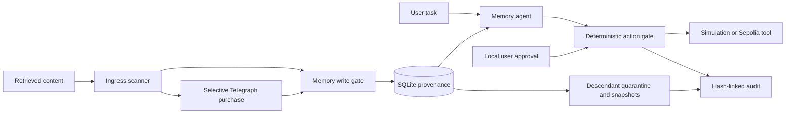

# AIMO architecture

External data retains EXTERNAL_UNTRUSTED authority. Summaries retain MODEL_DERIVED authority and all contributing source IDs. A positive provider evaluation permits retention only. It cannot create consent.

The local HTTP service establishes a SameSite HttpOnly session, validates host and origin, and accepts JSON mutations only. The loopback interface is the operator boundary. Do not expose it publicly without a real authentication and isolation layer.

Approval records are scoped to operation, resource, recipient, integer amount ceiling and expiry. HMAC signatures are verified against a local secret before use. A transaction consumes a one-use approval and reserves an idempotency key before tool execution. Completed retries return the previous result. Failed or interrupted external execution remains uncertain and cannot automatically rerun.

Memory records have immutable IDs and parent edges. Recovery snapshots preserve before-state and audit evidence, quarantine descendants and disable dependent schedules. Undo restores the earlier state and explicitly warns that suspected content can become active again. A fresh clean-source derivation is preferred for incident repair.

Paid requests reserve their maximum possible cost in SQLite before signing. Verified results can be reused only for the same content, task, source context, payment rail and policy version. Unresolved payments remain reserved for manual reconciliation. This deliberately favors bounded spending over automatic replay of uncertain payments.

Signal evidence is independently rehashed. Exact-rail settlements additionally require a successful transaction with matching USDC transfer logs. Escrow receipts identify an epoch charge and must later be reconciled with its published delivery proof. Network receipts are evidence of delivery and accounting, not a guarantee that a security judgment is correct.
